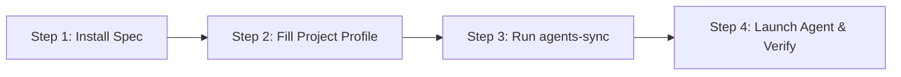

# UCNA-Spec: Universal Clean Native Agent Specification

[](https://opensource.org/licenses/MIT)
[](https://agentskills.io/specification)
[](#tool-compatibility-verified-2026-10-14)
[](#tool-compatibility-verified-2026-10-14)

> **The open-source, model-agnostic coding specification that makes autonomous AI agents write clean, idiomatic, and robust software native from scratch, just like an experienced principal engineer.**

One source of truth ([`AGENTS.md`](AGENTS.md)), loaded natively by all major agent tools, with zero dependency bloat, strict type invariants, and a deterministic 5-step anti-hallucination protocol.

---

## Quickstart: Install into Any Project

Choose your preferred installation method:

### Method 1: Instant Terminal One-Liner (Recommended)

Run this command inside the root of your existing repository:

```sh
curl -fsSL https://raw.githubusercontent.com/gerrardgs/Projects23/main/scripts/install.sh | bash
```

This downloads the core specification, configures your rules and skills, runs the synchronization script, and prepares your project for all AI agent tools in seconds.

---

### Method 2: Git Clone & Local Copy

Clone the repository and copy the specification into your project:

```sh
# 1. Clone UCNA-Spec
git clone https://github.com/gerrardgs/Projects23.git ucna-spec

# 2. Copy the spec into your project
cp -r ucna-spec/.agents ucna-spec/AGENTS.md ucna-spec/CLAUDE.md ucna-spec/GEMINI.md ucna-spec/.github ucna-spec/scripts /path/to/your/project/

# 3. Enter your project and sync mirrors
cd /path/to/your/project
node scripts/agents-sync.mjs
```

---

### Method 3: GitHub Fork & Templates

1. Click **Fork** at the top-right of [github.com/gerrardgs/Projects23](https://github.com/gerrardgs/Projects23).
2. Clone your fork locally or use it as a template for new repositories.
3. Keep your fork updated with upstream changes to receive new skills and updated runtime baselines.

---

## Step-by-Step Implementation Workflow

To get the full power of UCNA-Spec, follow this 4-step workflow:



1. **Install the files**: Use the terminal one-liner or copy the files into your project root.
2. **Fill in the Project Profile**: Open [`AGENTS.md`](AGENTS.md) and scroll to **Section 8 ("Project profile")**. Fill in your runtime version, package manager commands, test runner, and linter (e.g., `npm test`, `cargo test`, `ruff check`).
3. **Run the Sync Engine**:
   ```sh
   node scripts/agents-sync.mjs
   ```
   This generates `.claude/skills/` (for Claude Code and Cline) and validates frontmatter, token budgets, and relative links.
4. **Launch Your Agent**: Open your project in Google Antigravity, Claude Code, Cursor, Windsurf, or GitHub Copilot. Your agent will automatically adhere to the specification.

---

## Non-Negotiable Operational Rules

Anyone adopting UCNA-Spec must follow these core engineering non-negotiables:

1. **Do not fabricate (Zero Hallucination)**: Never invent APIs, CLI flags, package names, versions, or test results. Verify external symbols against installed code, `--help`, or official docs ([03-verification](.agents/rules/03-verification.md)).
2. **Deliver complete work**: No placeholder comments (`// TODO`), elided bodies (`...`), or stubbed returns in finished code.
3. **Never silence the toolchain**: No unconstrained `any`, `@ts-ignore`, `# type: ignore`, `//nolint`, or weakened assertions without an inline justification.
4. **Standard Library First (Zero Bloat)**: Prioritize standard runtime libraries (Node.js, Python stdlib, Go standard library, Rust std) before introducing external dependencies ([04-dependencies](.agents/rules/04-dependencies.md)).
5. **Deterministic Testing**: Every behavior change requires a deterministic test that fails without the change. Report exact terminal commands and actual output.

---

## Architecture & System Organization

UCNA-Spec follows a **two-tier progressive disclosure model** to prevent context window saturation and instruction drift:

| Layer | Location | Loading Mode | Purpose |
| :--- | :--- | :--- | :--- |
| **Core** | [`AGENTS.md`](AGENTS.md) | Always-On | Priorities, non-negotiables, workflow, and definition of done (~100 lines) |
| **Rules** | [`.agents/rules/`](.agents/rules/) | Always-On / Progressive | Short normative standards: principles, clean code, verification, dependencies, error handling |
| **Skills** | [`.agents/skills/`](.agents/skills/) | On-Demand | Step-by-step runbooks with verified runnable templates ([Agent Skills](https://agentskills.io/specification) format) |
| **Documentation** | [`docs/`](docs/) | Reference | Comprehensive system design, operational manual, anti-hallucination playbook, contributing guide |
| **Adapters** | `CLAUDE.md`, `GEMINI.md`, `.github/copilot-instructions.md`, `.aider.conf.yml` | Tool-Specific | Thin pointers so each tool loads the same core without duplication |
| **Mirrors** | `.claude/skills/` | Auto-Generated | Mirror of `.agents/skills/` for Claude Code and Cline (managed by sync script) |
| **Tooling** | [`scripts/agents-sync.mjs`](scripts/agents-sync.mjs) | Manual / CI | Syncs mirrors and validates frontmatter, token limits, and links |

---

## Tool Compatibility (Verified 2026-10-14)

| Tool / Platform | Reads Core | Reads Rules | Reads Skills | Official Source |
| :--- | :--- | :--- | :--- | :--- |
| **Claude Code** | `CLAUDE.md` (imports `AGENTS.md`) | Via index in `AGENTS.md` | `.claude/skills/` (mirror) | [Claude Code Memory](https://code.claude.com/docs/en/memory) |
| **Google Antigravity** | `AGENTS.md`, `GEMINI.md` | Native (`trigger` frontmatter) | `.agents/skills/` | [Antigravity Rules](https://antigravity.google/docs/rules) |
| **Gemini CLI** | `GEMINI.md` + `AGENTS.md` (via `.gemini/settings.json`) | Via index | `.agents/skills/` | [Gemini CLI Context](https://geminicli.com/docs/cli/gemini-md/) |
| **Cursor IDE** | `AGENTS.md` | Via index | `.agents/skills/` | [Cursor Rules](https://cursor.com/docs/context/rules) |
| **Windsurf / Devin** | `AGENTS.md` | Via index | `.agents/skills/` | [Windsurf Cascade](https://docs.devin.ai/desktop/cascade/memories) |
| **GitHub Copilot** | `.github/copilot-instructions.md`, `AGENTS.md` | Via index | `.agents/skills/` | [Copilot Custom Instructions](https://docs.github.com/en/copilot/how-tos/configure-custom-instructions/add-repository-instructions) |
| **Cline** | `AGENTS.md` | Via index | `.claude/skills/` (mirror) | [Cline Customization](https://docs.cline.bot/customization/skills.md) |
| **Aider CLI** | `AGENTS.md` (via `.aider.conf.yml`) | Via index | Manual reference | [Aider Conventions](https://aider.chat/docs/usage/conventions.html) |
| **Web Chat Models** | Paste [`AGENTS.md`](AGENTS.md) as system prompt | Manual paste | Manual paste | Universal Prompting |

---

## Supporting Documentation

Deepen your engineering knowledge with the supporting documentation:

- [Architecture & Systems Design](docs/ARCHITECTURE.md): Progressive disclosure theory, token budgeting mathematics (< 27% footprint), and tool loading mechanics.
- [Agent Operational Manual](docs/AGENT-OPERATIONAL-MANUAL.md): Step-by-step procedures for greenfield development, refactoring, bisection debugging, and PR reviews.
- [Anti-Hallucination Playbook](docs/ANTI-HALLUCINATION-PLAYBOOK.md): Concrete countermeasures against phantom packages, fabricated flags, and deprecations.
- [Contributing Guide](docs/CONTRIBUTING.md): Authoring standards, frontmatter schemas, and validation workflows.

---

## Verified Templates Included

The specification includes runnable, production-grade template architectures in [`.agents/skills/native-from-scratch/assets/`](.agents/skills/native-from-scratch/assets/):

1. **Node.js Native HTTP Service** ([`assets/node-http-service/`](.agents/skills/native-from-scratch/assets/node-http-service/)): Zero-dependency HTTP service built with `node:http`, strict typing, input size limits, graceful shutdown, and 12 passing tests using built-in `node:test`.
2. **Python Native HTTP Service** ([`assets/python-http-service/`](.agents/skills/native-from-scratch/assets/python-http-service/)): Standard library HTTP service built with `http.server`, `urllib`, and 11 passing tests using built-in `unittest` (passes `mypy --strict` and Ruff).

---

## Continuous Integration & Quality Assurance

To validate the specification in your CI pipeline, add `node scripts/agents-sync.mjs --check`:

```sh
# Self-tests for parser
node --test "scripts/*.test.mjs"

# Validate skills, rule triggers, token budgets, and links
node scripts/agents-sync.mjs --check
```

---

## Roadmap

- **Stage 1 (Completed):** Core architecture, cross-tool adapters, validator, verified Node.js and Python native templates. See [CHANGELOG.md](CHANGELOG.md).
- **Stage 2 (In Progress):** Testing and Git workflow rules; project bootstrap skills per language (Go, Rust, TypeScript, Python).
- **Stage 3:** Security hardening (OWASP ASVS, secret scanning, SBOM) and SHA-pinned CI/CD workflows.
- **Stage 4:** Polyglot toolchain catalog and performance profiling benchmarks.

---

## License

[MIT](https://opensource.org/licenses/MIT) © 2026 Gerrard Sebastian. Free for personal, commercial, and enterprise use worldwide.
