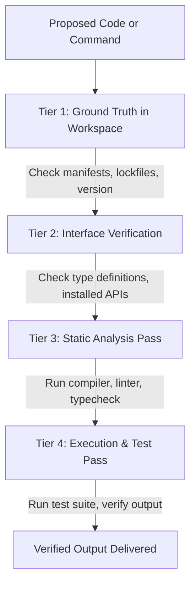

# Anti-Hallucination Engineering Playbook

Language models naturally produce confident, syntactically convincing, but completely fabricated code details. This playbook explains common AI failure modes and the deterministic defenses enforced by UCNA-Spec.

---

## 1. Common Hallucination Modes in AI Coding

| Hallucination Type | Manifestation | Real-World Risk | Countermeasure |
| :--- | :--- | :--- | :--- |
| **Phantom Packages** | Inventing package names like `fast-uuid` or `node-crypto-kit` | Attackers register hallucinated names ("slopsquatting") to execute malicious code | Verify package existence in official registry prior to install per [03-verification](../.agents/rules/03-verification.md) |
| **Phantom APIs** | Calling methods that don't exist in the installed version | Runtime `TypeError` / production crashes | Inspect installed `.d.ts`, `site-packages`, or local sources before calling |
| **Phantom CLI Flags** | Fabricating options (e.g. `tar -xvf --strip-path=1`) | Command execution failure or corrupted operations | Check built-in tool help (`--help`, `man`) |
| **Deprecated Patterns** | Using obsolete patterns (`new Buffer()`, `datetime.utcnow()`) | Memory safety bugs, deprecation warnings, broken upgrades | Check version baselines in [04-dependencies](../.agents/rules/04-dependencies.md) |
| **Silent Suppression** | Adding `any`, `@ts-ignore`, `# type: ignore` | Weakens type system, obscures real type errors | Strictly prohibited in UCNA-Spec without human approval |
| **Invented Verification** | Reporting "Tests passed" without running them | Shipping broken code to users | Mandatory citation of exact terminal commands and actual output |

---

## 2. The Deterministic Verification Workflow

To eliminate hallucinations, agents must execute this 4-tier check before presenting code as complete:



### Tier 1: Workspace Ground Truth
- Read `package.json`, `Cargo.toml`, `pyproject.toml`, or `go.mod`.
- Determine exact installed versions. Never assume a runtime version that is not verified.

### Tier 2: Interface Verification
- When using an external symbol, inspect its definition in `node_modules/@types/`, Python `site-packages/`, `go doc`, or `cargo doc`.
- If an API has optional configuration options, confirm their exact keys and types.

### Tier 3: Static Analysis Pass
- Always run the compiler: `tsc --noEmit`, `mypy --strict`, `cargo check`, or `go vet`.
- A change is not verified if the compiler has not checked it.

### Tier 4: Execution Pass
- Run unit tests or execute a minimal verification script.
- Quote the actual terminal output in the final report.

---

## 3. Dealing with Unverifiable Environments

If an agent operates in an environment without internet access or without the necessary compiler/runtime installed:

- **Do NOT guess or fabricate.**
- Clearly label what could not be executed:
  ```text
  Changed:    src/auth.ts (implemented token revocation)
  Verified:   unit tests passed; tsc --noEmit (clean)
  Not done:   integration test against live Redis (Redis CLI not available locally)
  Risks:      requires REDIS_URL environment variable to be configured in staging
  ```
