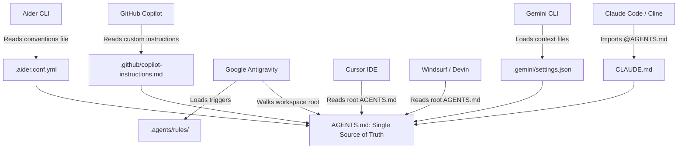

# Architecture and Systems Design

This document details the architectural principles, cognitive loading theory, and multi-tool orchestration mechanics behind the Universal Clean Native Agent Specification (UCNA-Spec).

---

## 1. The Core Problem: Agent Degradation Under Instruction Bloat

Language models exhibit marked degradation in reasoning, instruction following, and code synthesis when overloaded with excessive context. Research into context window dynamics (such as "Lost in the Middle" phenomena and attention dispersion) demonstrates:

1. **Large monolithic prompt degradation**: When prompt instructions exceed 300-400 lines, models frequently miss negative constraints ("never use `any`") or selectively apply rules.
2. **Context starvation**: Bloating always-on instructions with language-specific boilerplate consumes valuable token budget that should be reserved for the user's actual codebase, AST context, and dependency trees.
3. **Tool conflicts**: Different tools (Claude Code, Cursor, Windsurf, Antigravity) expect instructions in distinct file locations and formats. Duplicating rules across multiple uncoordinated files leads to instruction drift and contradictory mandates.

---

## 2. The Solution: Progressive Disclosure & Lean Core

UCNA-Spec implements a **two-tier progressive disclosure model**:

```
+-------------------------------------------------------------------+
| LAYER 1: Lean Always-On Core (AGENTS.md)                          |
| - Priorities, Non-negotiables, Universal Workflow, Definition of Done |
| - Size: ~100 lines (~1,300 tokens)                                |
+-------------------------------------------------------------------+
                               |
               +---------------+---------------+
               |                               |
               v                               v
+-----------------------------+ +-----------------------------+
| LAYER 2A: Rules (Targeted)  | | LAYER 2B: Skills (Procedures) |
| - Loaded on demand/decision | | - Loaded on explicit workflow |
| - 01-core-principles.md     | | - native-from-scratch         |
| - 02-clean-code.md          | | - rigorous-code-audit         |
| - 03-verification.md        | | - Runnable verified assets    |
| - 04-dependencies.md        | |                               |
| - 05-error-handling.md      | |                               |
+-----------------------------+ +-----------------------------+
```

### Mathematical Token Budgeting
- **Always-On Budget**: Antigravity budgets 20,000 tokens for always-on rules; Claude Code recommends under 200 lines per `CLAUDE.md`.
- **UCNA-Spec Footprint**: `AGENTS.md` is strictly capped at ~100 lines. Together with `always_on` rules, the baseline footprint is approximately **5,340 tokens**, consuming less than 27% of the maximum budget and leaving 73%+ for repository reasoning.

---

## 3. Tool Ingestion Architecture

Every major autonomous coding tool accesses the exact same single source of truth without duplication:



---

## 4. The Mirror Synchronization Engine (`scripts/agents-sync.mjs`)

To support tools that require isolated skill directories (e.g., Claude Code and Cline requiring `.claude/skills/`), UCNA-Spec provides a zero-dependency synchronization and validation script:

1. **Single Source of Truth**: All skills are authored and edited in `.agents/skills/`.
2. **Deterministic Hashing**: The script hashes files using SHA-256 and copies changes into `.claude/skills/`.
3. **Manifest Tracking**: The `.agents-sync.json` manifest ensures stale mirrors of deleted skills are pruned automatically without touching unmanaged files.
4. **Specification Auditing**: Enforces the Agent Skills Open Specification (name patterns, description lengths, line counts, relative link validity).
